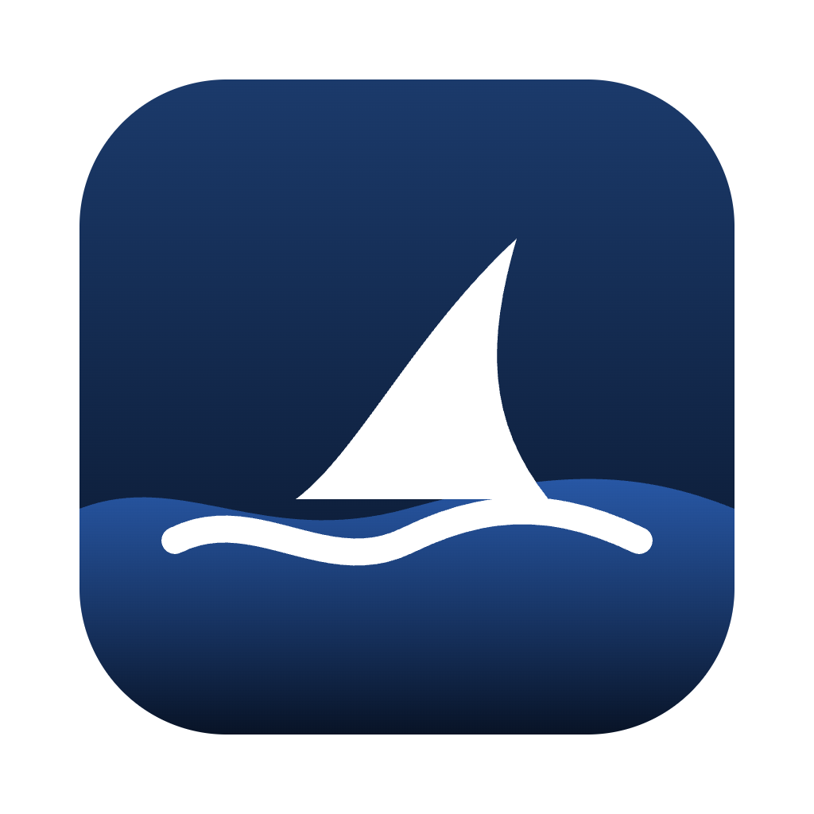

<h1 align="center">
   Shark
</h1>

<p align="center">
  AI 코딩 도우미(Claude Code 등)와 채팅하면서 코드를 만드는 맥 앱이에요.<br/>
  오픈소스 앱 <a href="https://github.com/stablyai/orca">Orca</a>(MIT 라이선스)를 내 입맛대로 고쳐서 만들었어요.
</p>

## 설치하기 (맥)

> **필요한 것**: M1·M2·M3·M4 같은 **M 칩 맥**. 인텔 맥에서는 안 돌아가요.
> AI와 채팅하려면 [Claude Code](https://docs.claude.com/en/docs/claude-code/overview) 같은 AI 코딩 도구도 먼저 깔려 있어야 해요.

1. 이 저장소의 [**Releases**](../../releases/latest) 페이지에서 `Shark-mac-arm64.zip` 을 내려받아요.
2. 내려받은 zip 을 더블클릭해서 압축을 풀어요. `Shark` 앱이 나와요.
3. `Shark` 를 Finder 의 **응용 프로그램** 폴더로 끌어다 놓아요.
4. **터미널**을 열고 아래 한 줄을 붙여 넣은 뒤 Enter 를 눌러요.

   ```sh
   xattr -dr com.apple.quarantine /Applications/Shark.app
   ```

   Shark 는 애플 인증을 받지 않은 앱이라, 이 줄을 안 넣으면 "손상되었기 때문에 열 수 없습니다" 라는 창이 떠요.
   이 명령은 "인터넷에서 받은 앱" 표시만 지워 주는 거예요.

5. 응용 프로그램 폴더에서 **Shark** 를 더블클릭해서 켜요.

### 처음 켜면

"어느 폴더에서 작업할까요?" 창이 떠요. 최근 폴더를 고르거나 **다른 폴더 열기**로 작업할 폴더를 고르면 돼요.
그다음 채팅창에 하고 싶은 일을 적으면 AI가 그 폴더에서 일을 시작해요.

### 새 버전으로 바꾸기

Shark 는 스스로 업데이트하지 않아요. 새 버전이 나오면 Releases 에서 다시 받아 위 순서대로 덮어쓰면 돼요.

## Orca 에서 바뀐 것

- 이름·아이콘·남색 테마를 Shark 로
- 켜면 작업할 폴더를 먼저 물어봄
- 원클릭으로 새 프로젝트·새 세션 시작, 첫 메시지로 세션 제목 자동 짓기
- 웹 서버를 켜면 채팅 옆에 미리보기가 자동으로 열림 (설정에서 끌 수 있음)
- 미리보기에서 요소를 바로 지적하기, 콘솔 에러를 AI에게 보내기, 폰 화면 크기로 보기
- 한 번에 커밋+푸시, AI 작업이 끝나면 알림, 하루 지난 빈 세션 자동 정리
- 위 기능들을 창 맨 위 버튼으로 바로 쓰기
- 원본 Orca 로 자동 업데이트되지 않게 막음

## 직접 만들어 보기 (개발자용)

[Node.js](https://nodejs.org), [pnpm](https://pnpm.io), Xcode Command Line Tools(`xcode-select --install`) 가 필요해요.

```sh
git clone https://github.com/mjfingers2/shark.git
cd shark
pnpm install
pnpm -C mobile install --frozen-lockfile
pnpm dev          # 개발용으로 켜기
```

맥 앱으로 굽기(M 칩용만):

```sh
pnpm run build:desktop
pnpm run build:computer-macos
node config/scripts/native-build/macos/build-keyboard-layout-macos.mjs --single-arch
node config/scripts/native-build/macos/build-process-footprint-macos.mjs --single-arch
node config/scripts/native-build/macos/build-notification-status-macos.mjs --single-arch
pnpm run ensure:electron-runtime
pnpm exec electron-builder --config config/electron-builder.config.cjs --mac --arm64 --dir
codesign --force --deep --sign - dist/mac-arm64/Shark.app
```

`dist/mac-arm64/Shark.app` 이 만들어져요.

## 라이선스

[MIT](LICENSE). 원본 Orca 는 Lovecast Inc. 가 만들었고, 원래 설명은 [docs/readme/README.orca.md](docs/readme/README.orca.md) 에 남겨 두었어요.
